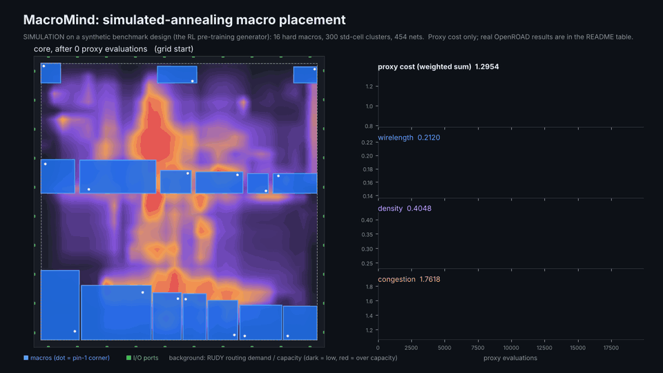
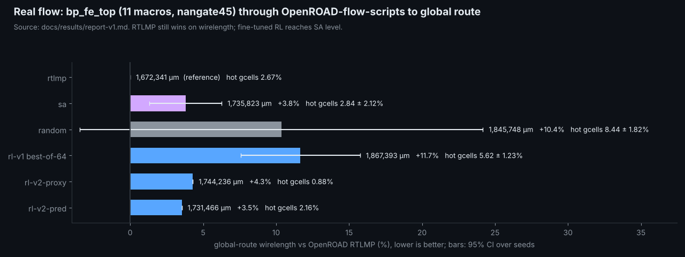

# MacroMind

Learned macro placement (GNN + RL) and PPA prediction for OpenROAD. MacroMind places the hard macros of a chip inside OpenROAD-flow-scripts (ORFS) through ORFS's own `MACRO_PLACEMENT_TCL` hook. It has three parts:

- classical baselines (random, grid packing, simulated annealing on a TILOS-style proxy cost)
- a graph-neural-network policy trained with PPO
- learned congestion and wirelength predictors that can stand in for the proxy as a reward

Every result is measured on the real flow (global route) and compared with OpenROAD's own RTLMP placer.



*The SA placer on a synthetic benchmark design (16 macros, 300 std-cell clusters). The animation samples the committed state from inside a real `sa_place` run: macro positions, the RUDY routing-demand map, and the proxy cost components. This is a **simulation of the proxy optimisation only**; real-flow numbers are below. [MP4](docs/media/sa-placement.mp4)*

## Results (bp_fe_top, nangate45, ORFS to global route)



- Fine-tuning the RL v1 policy on bp_fe_top for about 30 CPU-minutes cuts global-route wirelength by about 7%, to the level of SA.
- RTLMP still wins: the RL policy is 3.5–4.3% behind it.
- RL v2 has the best proxy score of any placer but not the best real wirelength. The proxy optimum is not the global-route optimum.
- On unseen placements the learned predictor ranks real outcomes better than the proxy (Kendall τ 0.52 vs 0.32 for wirelength, 0.58 vs 0.23 for congestion).
- A policy trained against the predictor still found a placement whose congestion the predictor got wrong (reward hacking).

The full write-up is in [`docs/results/report-v1.md`](docs/results/report-v1.md). Also see [`docs/results/orfs-first-runs.md`](docs/results/orfs-first-runs.md) (tinyRocket and bp_fe sweeps) and [`docs/results/predictors-v1.md`](docs/results/predictors-v1.md).

## Layout

| Path | Contents |
|---|---|
| `macromind/core`, `io` | `Design` model, LEF/DEF and Bookshelf readers, synthetic design generator |
| `macromind/cost` | Proxy cost: HPWL, density, RUDY congestion, incremental updates |
| `macromind/legalize`, `baselines` | Legaliser; random, grid and SA placers |
| `macromind/graph`, `place` | Clustering, graph tensors, RL environment, GNN policy, PPO, fine-tuning |
| `macromind/predict` | Data generation from ORFS runs, congestion/timing predictors |
| `macromind/harness`, `flow`, `report` | ORFS runner and placement hook, PPA JSON, report tables |
| `designs/` | tiny-gpu and SpikeMesh macro-placement designs |
| `docs/` | Plan, scope, harness and toolchain notes, results |

## Running

```bash
pytest -q                                                       # unit tests (no EDA tools needed)
scripts/setup_toolchain.sh && scripts/smoke_orfs.sh gcd          # OpenROAD + Yosys + ORFS platforms
python -m macromind.harness run --design nangate45/bp_fe_top --placer macromind-sa --seed 0 --stop-after grt
python -m macromind.report                                       # tables from the run directories
python3 scripts/media.py                                           # regenerate the README media
```

See [`docs/harness.md`](docs/harness.md) and [`docs/toolchain.md`](docs/toolchain.md) for details.
